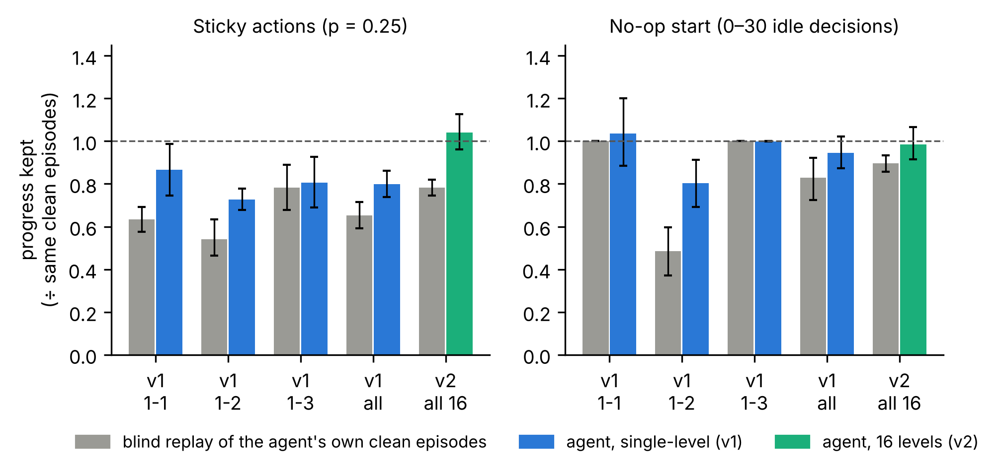
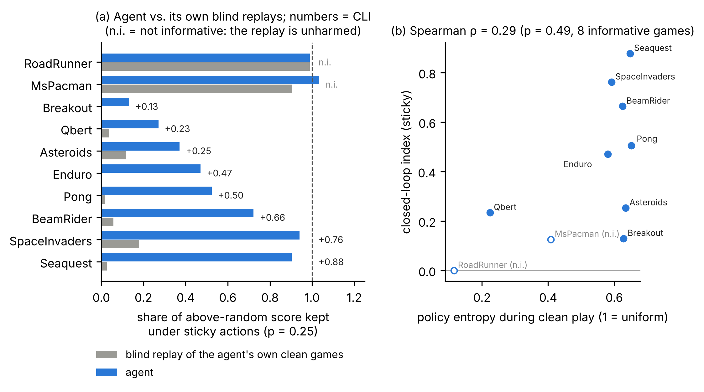

<h1 align="center">Playing from Memory</h1>

<p align="center">
<b>A retraining-free audit of pixel-based PPO agents in <i>Super Mario Bros.</i> and Atari</b><br>
Do trained agents react to what they see, or replay a memorised button sequence?
</p>

<p align="center">


</p>

---

This repository contains every experiment and result behind **"Playing from Memory: A Retraining-Free Audit of Pixel-Based PPO Agents in *Super Mario Bros.*"** (preprint forthcoming).

It started as an architecture study: does spatial self-attention help a PPO agent learn Mario from pixels and generalise to new levels? It did not. Instead of training more, the project asks what the 31 trained agents actually learned, using tests that need no retraining. Its main tool is a new measure, the **closed-loop index**. The measure is then applied unchanged to 10 Atari agents published by the Stable-Baselines3 team.

## Key findings

| | Finding |
|---|---|
| **Fragile skill** | Single-level Mario agents keep a median of only **0.55** of their above-random progress when 25% of button presses are repeated (sticky actions), and **0.46** when the screen moves 6 pixels. Delayed starts and a frozen game clock have no effect. |
| **Closed-loop index** | Single-level agents recover **42%** of what blind replays of their own games lose. The best-trained agents (level 1-3) recover almost none of it (**+0.02**), and they are the only group that plays **worse than random** on unseen levels (0.70×). Agents trained on 16 levels recover all of it (**+0.26**). |
| **Sampling noise, not skill** | On unseen levels, taking the most likely action instead of sampling drops single-level agents to **0.51–0.75× random**. Their near-random transfer comes from randomness. |
| **Attention** | Spatial attention gave no learning or transfer benefit. Switching it off changes nothing on unseen levels. Broader training makes it more focused, and only a sparse top-*k* variant passes an occlusion faithfulness test. |
| **Atari** | All 100 clean games of 10 published PPO agents replay exactly. In **7 of the 8** games where the test is informative, the agents clearly react to the screen (index **+0.13 to +0.88**), yet 5 of them still lose over 40% of their score under sticky actions. **Using the screen is not the same as being robust.** |

<p align="center">
<br>
<sub>Progress kept by each agent (colour) and by a blind replay of its own clean games (grey) under the same perturbation. The gap is the closed-loop index.</sub>
</p>

<p align="center">
<br>
<sub>The same test on 10 published Atari agents. Left: agent vs. its own blind replays under sticky actions. Right: index vs. how decisive the policy is.</sub>
</p>

## The closed-loop index in one paragraph

NES and Atari emulators are deterministic: the same buttons from the same start always produce the same game. So the button sequence of a clean game (its *tape*) replays that game exactly; this repository checks it on every game (526 in Mario, 100 in Atari, all exact). Disturb both the agent and its tape in the same way, for example by repeating 25% of the presses, and compare how much progress each keeps:

```
CLI = (progress kept by the agent) − (progress kept by a blind replay of its own clean games)
```

**CLI ≈ 0:** the agent does no better than a recording of itself; it is playing from memory. **CLI > 0:** it uses the screen to recover. A disturbance only tells you something where it actually hurts the blind replay, and the tape shows that directly.

## Repository map

| File | What it does | Training? | Time |
|---|---|---|---|
| [`Mario_RL_Attention_Research.ipynb`](Mario_RL_Attention_Research.ipynb) | **Study 1 (v1).** NatureCNN vs. + channel attention (SE) vs. + spatial self-attention, on levels 1-1, 1-2, 1-3, 3 seeds × 1M steps. Learning curves, statistics, zero-shot transfer, attention maps, latency. | yes, GPU | ≈ 17 h |
| [`Mario_RL_Generalization.ipynb`](Mario_RL_Generalization.ipynb) | **Study 2 (v2).** 16 training levels, 6 held-out levels, random-shift augmentation (DrAC), dense and sparse positional attention, 3M steps. | yes, GPU | ≈ 2–3 h per model |
| [`Mario_RL_Audit.ipynb`](Mario_RL_Audit.ipynb) | **The audit.** Perturbations, closed-loop index, greedy vs. sampled play, test-time interventions, representation probes, attention faithfulness, predictors of transfer, on all saved Mario agents. | no, CPU | a few hours |
| [`Atari_CLI_Audit.ipynb`](Atari_CLI_Audit.ipynb) | **Atari extension.** Downloads 10 published RL Zoo PPO agents and runs the determinism check and closed-loop index. | no, CPU | ≈ 10 min |
| [`watch_agent.py`](watch_agent.py) | Watch any trained Mario agent play in a live window, or save a GIF. | – | – |
| [`run_experiments.sh`](run_experiments.sh) / [`stop_experiments.sh`](stop_experiments.sh) | Run any notebook headless in the background, resumable; stop it gracefully. | – | – |
| [`setup.sh`](setup.sh) | Creates the Python environments. | – | – |
| `results/` | Outputs of study 1 (figures, tables, logs). | | |
| `results_generalization/` | Outputs of study 2 (seed 42). | | |
| `results_audit/` | Outputs of the audit, including raw per-episode CSVs. | | |
| `results_atari/` | Outputs of the Atari extension. | | |

Each `results*/` folder has a `summary.md` with every table and figure, `tables/` (CSV, Markdown, LaTeX), `figures/` (PNG and PDF), and raw data.

## Setup

Tested on Ubuntu with Python 3.12 and an NVIDIA RTX 4050 laptop GPU. A GPU is only needed for training; both audits run on CPU.

```bash
git clone <this repository's URL> playing-from-memory
cd playing-from-memory
sudo apt install python3-venv python3-full    # Ubuntu/Debian, once
./setup.sh all                                 # creates .venv (Mario) and .venv-atari (Atari)
```

**Why two environments?** The Mario emulator on Python < 3.13 needs the old `gym` API and NumPy 1.26, while the Atari emulator needs a recent Gymnasium. Keeping them separate avoids version conflicts.

<details>
<summary>Manual setup, or if <code>setup.sh</code> fails</summary>

```bash
# Mario
python3 -m venv .venv && source .venv/bin/activate
pip install torch                 # first! see pytorch.org for older NVIDIA drivers
pip install -r requirements.txt
python -c "import torch; print(torch.__version__, torch.cuda.is_available())"
deactivate

# Atari
python3 -m venv .venv-atari && source .venv-atari/bin/activate
pip install torch --index-url https://download.pytorch.org/whl/cpu
pip install -r requirements-atari.txt
```

**Troubleshooting**
- `Command 'python' not found` → use `python3`, or activate the environment first.
- `externally-managed-environment` → you are installing outside a virtual environment; activate `.venv` first.
- `undefined symbol: ncclCommResume` when importing torch → `unset LD_LIBRARY_PATH`, then `pip install --force-reinstall --no-cache-dir torch`.
- NumPy was upgraded to 2.x in the Mario environment (for example by an IDE suggestion) → `pip install numpy==1.26.4`.
- The game window fails with `Library "GLU" not found` → `sudo apt install libglu1-mesa`.
- `OpenCV is not installed` (Atari) → `pip install opencv-python-headless`.
</details>

## Running

Every notebook can be opened in Jupyter and run top to bottom, or run headless in the background:

```bash
source .venv/bin/activate
NOTEBOOK=Mario_RL_Attention_Research.ipynb ./run_experiments.sh     # study 1
NOTEBOOK=Mario_RL_Generalization.ipynb ./run_experiments.sh         # study 2
NOTEBOOK=Mario_RL_Audit.ipynb ./run_experiments.sh                  # audit (needs the checkpoints of 1 and 2)
tail -f runs/latest.log                                             # follow progress
./stop_experiments.sh                                               # stop; re-run the same command to resume

source .venv-atari/bin/activate
NOTEBOOK=Atari_CLI_Audit.ipynb ./run_experiments.sh                 # Atari extension
```

Start one run at a time. Any parameter in a notebook's first cell can be overridden:

```bash
NOTEBOOK=Mario_RL_Generalization.ipynb ./run_experiments.sh -y 'SEEDS: [123, 777]'
NOTEBOOK=Atari_CLI_Audit.ipynb ./run_experiments.sh -y 'GAMES: [Pong, Breakout]' -p EPISODES 3
NOTEBOOK=Mario_RL_Audit.ipynb ./run_experiments.sh -p N_WORKERS 6
```

All runs are resumable: finished training runs, evaluations and audit jobs are saved and skipped on a re-run. Pass `-p REEVALUATE True` to recompute evaluations.

**Watch an agent play**

```bash
python watch_agent.py --level 1-3 --model spatial --seed 42                    # on its own level
python watch_agent.py --level 1-3 --model spatial --seed 42 --test-level 1-1   # on a level it never saw
python watch_agent.py --checkpoint checkpoints_generalization/sparse_aug_s42/sparse_aug_s42_final.zip --test-level 4-2
python watch_agent.py --random --test-level 1-1                                # random play, for comparison
```

Options: `--episodes N`, `--speed 2`, `--deterministic`, `--record` (saves a GIF to `results/videos/`), `--no-window`.

## Trained models

Model weights are not stored in git: each is about 54 MB, about 1.7 GB for all 31. GitHub release files can be up to 2 GB each, so attach them to a release as two archives:

```bash
zip -r -0 mario_v1_checkpoints.zip checkpoints                     # 27 single-level agents, ≈ 1.5 GB
zip -r -0 mario_v2_checkpoints.zip checkpoints_generalization      # 4 sixteen-level agents, ≈ 0.2 GB
gh release create v1.0 mario_v1_checkpoints.zip mario_v2_checkpoints.zip \
    --title "Trained agents" --notes "The 31 Mario PPO agents audited in the paper"
```

Unzip the release into the repository root to run the audit without retraining. The Atari agents are downloaded automatically from Hugging Face (`sb3/ppo-<Game>NoFrameskip-v4`).

## Method details

| Setting | Value |
|---|---|
| Algorithm | PPO (Stable-Baselines3), 8 parallel environments, 512 steps per rollout, lr 1e-4 |
| Observation | 4 stacked 120×128 grayscale frames, frame skip 4, 7 actions |
| Score | furthest x reached ÷ a uniform random policy on the same level (1.0 = random) |
| Perturbations | no-op start (0–30 idle decisions), sticky actions (p = 0.25), frozen HUD, 6-pixel shift |
| Statistics | paired Wilcoxon tests with Holm correction; 95% bootstrap confidence intervals; Spearman correlations |

Full settings are in each run's `config.json`.

## Limitations

- Study 2 has one seed per encoder, so comparisons between its encoders need replication.
- Study 1 covers three training levels, so between-level patterns rest on three groups of nine models.
- The closed-loop index requires a deterministic environment; the 20% threshold for an informative perturbation is a convention.
- All Mario agents were trained with a modest budget on a laptop GPU.

## Future work

1. **More seeds for study 2.** Train seeds 123 and 777 (`-y 'SEEDS: [123, 777]'`) so the encoder comparisons and the sparse-attention faithfulness result become firm.
2. **"Kick the agent": impulse-response analysis.** Snapshot the emulator mid-game, force one wrong button press, and measure whether, how fast and where the agent returns to its original path, compared with its blind replay. This gives a time-resolved map of when an agent relies on vision. It needs no training.
3. **Does attention store level-specific detail?** Switch attention off on the *training* levels (not just unseen ones), and measure how much each encoder's internal features change when the screen shifts by a few pixels.
4. **Training against memorisation.** Train with sticky actions, random start points inside levels, and procedurally generated levels. Use the closed-loop index during training as an early-warning signal for memorisation.
5. **Sparse attention without a position embedding.** Test whether the learned 2D position embedding is what breaks the CNN's built-in shift robustness.
6. **Broader coverage.** Apply the index to other algorithms (DQN, IMPALA) and to the Mario agents with longer training budgets.

## Citation

```bibtex
@misc{pydi2026playing,
  title  = {Playing from Memory: A Retraining-Free Audit of Pixel-Based PPO Agents in Super Mario Bros.},
  author = {Pydi, Raja Raghu Ram},
  year   = {2026},
  note   = {Preprint}
}
```

## Acknowledgements

Built on [Stable-Baselines3](https://github.com/DLR-RM/stable-baselines3), [gym-super-mario-bros](https://github.com/Kautenja/gym-super-mario-bros), the [Arcade Learning Environment](https://github.com/Farama-Foundation/Arcade-Learning-Environment), and the [RL Baselines3 Zoo](https://github.com/DLR-RM/rl-baselines3-zoo) agents on Hugging Face. Parts of the code and text were drafted with the assistance of an AI model (Claude, Anthropic); all experiments were run and checked by the author.

Released under the [MIT License](LICENSE).
