# Results: Spatial Self-Attention Mechanisms vs. Dense Convolutions in Deep Reinforcement Learning for Real-Time Pixel-Based Controls

Generated 2026-10-30 04:44 · levels ['1-1', '1-2', '1-3'] · variants ['baseline', 'channel', 'spatial'] · seeds [42, 123, 777] · 1,000,000 target steps per run · config in `config.json`

### Model size (actor-critic policy incl. heads)

| Model | Block params | Total policy params | Overhead vs baseline (%) | Mixes positions | Mixes channels |
|:---|---:|---:|---:|---:|---:|
| NatureCNN (baseline) | 0 | 4,407,976 | 0.00 | no | no |
| + Channel attention (SE) | 580 | 4,408,556 | 0.01 | no | yes |
| + Spatial self-attention (ours) | 16,385 | 4,424,361 | 0.37 | yes | yes |
| + Pointwise MLP (capacity control) | 16,385 | 4,424,361 | 0.37 | no | yes |

### Training throughput (20 CPU cores, n_envs=8)

| Stage | Steps/s | Hours per 1M steps |
|:---|---:|---:|
| 1 env, random actions | 154.35 | 1.80 |
| 8 envs, random actions | 344.40 | 0.81 |
| PPO iteration: collect + update on CUDA | 254.18 | 1.09 |

### Ablation per level (mean ± std over seeds; T = {'1-1': 2000, '1-2': 1500, '1-3': 1000}; sustained = 50-episode mean)

| Level | Model | Seeds | Budget | AUC max x | Steps to sustained x ≥ T | Max x (last 100 ep) | Flag rate % (last 100 ep) | Train FPS |
|:---|---:|---:|---:|---:|---:|---:|---:|---:|
| 1-1 | NatureCNN (baseline) | 3 | 1,003,304 | 867 ± 5 | not reached | 922 ± 51 | 0.0 ± 0.0 | 394 ± 101 |
| 1-1 | + Channel attention (SE) | 3 | 1,003,304 | 861 ± 6 | not reached | 930 ± 66 | 0.0 ± 0.0 | 423 ± 11 |
| 1-1 | + Spatial self-attention (ours) | 3 | 1,003,304 | 868 ± 5 | not reached | 905 ± 49 | 0.0 ± 0.0 | 416 ± 5 |
| 1-2 | NatureCNN (baseline) | 3 | 1,003,248 | 883 ± 82 | 902,256 (1/3 seeds) | 1,406 ± 135 | 0.0 ± 0.0 | 452 ± 10 |
| 1-2 | + Channel attention (SE) | 3 | 1,003,248 | 778 ± 27 | not reached | 1,014 ± 44 | 0.0 ± 0.0 | 453 ± 19 |
| 1-2 | + Spatial self-attention (ours) | 3 | 1,003,248 | 876 ± 37 | 956,604 ± 55,273 (2/3 seeds) | 1,531 ± 166 | 2.0 ± 3.5 | 421 ± 9 |
| 1-3 | NatureCNN (baseline) | 3 | 1,003,328 | 729 ± 94 | 618,448 ± 77,341 (2/3 seeds) | 1,078 ± 257 | 0.0 ± 0.0 | 460 ± 27 |
| 1-3 | + Channel attention (SE) | 3 | 1,003,328 | 708 ± 96 | 649,404 ± 33,856 (2/3 seeds) | 1,073 ± 252 | 0.0 ± 0.0 | 479 ± 29 |
| 1-3 | + Spatial self-attention (ours) | 3 | 1,003,328 | 649 ± 48 | 820,800 (1/3 seeds) | 962 ± 310 | 0.0 ± 0.0 | 468 ± 25 |

### Pairwise comparisons (n = 3 seeds per arm; bootstrap 95% CI of the difference; Welch t-test, Holm-corrected within each metric)

| Metric | Level | Comparison | Mean A | Mean B | Difference | Relative (%) | 95% CI low | 95% CI high | Welch p | Lower is better | Censored seeds | Holm p |
|:---|---:|---:|---:|---:|---:|---:|---:|---:|---:|---:|---:|---:|
| AUC max x | 1-1 | spatial − baseline | 868 | 867 | 1.15 | 0.133 | -5.42 | 7.72 | 0.805 | no | 0 | 1 |
| AUC max x | 1-1 | channel − baseline | 861 | 867 | -5.88 | -0.679 | -12.6 | 0.976 | 0.273 | no | 0 | 1 |
| AUC max x | 1-1 | spatial − channel | 868 | 861 | 7.04 | 0.817 | -0.632 | 14.1 | 0.204 | no | 0 | 1 |
| AUC max x | 1-2 | spatial − baseline | 876 | 883 | -7.2 | -0.815 | -90.6 | 73.6 | 0.899 | no | 0 | 1 |
| AUC max x | 1-2 | channel − baseline | 778 | 883 | -105 | -11.9 | -188 | -23.9 | 0.148 | no | 0 | 1 |
| AUC max x | 1-2 | spatial − channel | 876 | 778 | 97.4 | 12.5 | 55.9 | 139 | 0.0242 | no | 0 | 0.218 |
| AUC max x | 1-3 | spatial − baseline | 649 | 729 | -80.1 | -11 | -171 | 22.3 | 0.281 | no | 0 | 1 |
| AUC max x | 1-3 | channel − baseline | 708 | 729 | -20.7 | -2.84 | -138 | 97 | 0.803 | no | 0 | 1 |
| AUC max x | 1-3 | spatial − channel | 649 | 708 | -59.4 | -8.39 | -145 | 51.4 | 0.41 | no | 0 | 1 |
| Steps to sustained x ≥ T | 1-1 | spatial − baseline | 1e+06 | 1e+06 | 0 | 0 | 0 | 0 | – | yes | 6 | – |
| Steps to sustained x ≥ T | 1-1 | channel − baseline | 1e+06 | 1e+06 | 0 | 0 | 0 | 0 | – | yes | 6 | – |
| Steps to sustained x ≥ T | 1-1 | spatial − channel | 1e+06 | 1e+06 | 0 | 0 | 0 | 0 | – | yes | 6 | – |
| Steps to sustained x ≥ T | 1-2 | spatial − baseline | 9.72e+05 | 9.7e+05 | 2.57e+03 | 0.265 | -5.97e+04 | 6.99e+04 | 0.956 | yes | 3 | 1 |
| Steps to sustained x ≥ T | 1-2 | channel − baseline | 1e+06 | 9.7e+05 | 3.37e+04 | 3.47 | 0 | 1.01e+05 | 0.423 | yes | 5 | 1 |
| Steps to sustained x ≥ T | 1-2 | spatial − channel | 9.72e+05 | 1e+06 | -3.11e+04 | -3.1 | -8.57e+04 | 0 | 0.374 | yes | 4 | 1 |
| Steps to sustained x ≥ T | 1-3 | spatial − baseline | 9.42e+05 | 7.47e+05 | 1.96e+05 | 26.2 | -6.08e+04 | 4.03e+05 | 0.277 | yes | 3 | 1 |
| Steps to sustained x ≥ T | 1-3 | channel − baseline | 7.67e+05 | 7.47e+05 | 2.06e+04 | 2.76 | -2.52e+05 | 2.93e+05 | 0.913 | yes | 2 | 1 |
| Steps to sustained x ≥ T | 1-3 | spatial − channel | 9.42e+05 | 7.67e+05 | 1.75e+05 | 22.8 | -6.08e+04 | 3.62e+05 | 0.281 | yes | 3 | 1 |
| Max x (last 100 ep) | 1-1 | spatial − baseline | 905 | 922 | -16.2 | -1.75 | -80.8 | 48.5 | 0.714 | no | 0 | 1 |
| Max x (last 100 ep) | 1-1 | channel − baseline | 930 | 922 | 8.43 | 0.915 | -67.2 | 82 | 0.871 | no | 0 | 1 |
| Max x (last 100 ep) | 1-1 | spatial − channel | 905 | 930 | -24.6 | -2.65 | -92.1 | 51 | 0.635 | no | 0 | 1 |
| Max x (last 100 ep) | 1-2 | spatial − baseline | 1.53e+03 | 1.41e+03 | 125 | 8.9 | -68.7 | 319 | 0.37 | no | 0 | 1 |
| Max x (last 100 ep) | 1-2 | channel − baseline | 1.01e+03 | 1.41e+03 | -392 | -27.9 | -541 | -280 | 0.0279 | no | 0 | 0.236 |
| Max x (last 100 ep) | 1-2 | spatial − channel | 1.53e+03 | 1.01e+03 | 517 | 51 | 372 | 674 | 0.0262 | no | 0 | 0.236 |
| Max x (last 100 ep) | 1-3 | spatial − baseline | 962 | 1.08e+03 | -116 | -10.7 | -453 | 243 | 0.646 | no | 0 | 1 |
| Max x (last 100 ep) | 1-3 | channel − baseline | 1.07e+03 | 1.08e+03 | -4.37 | -0.405 | -313 | 305 | 0.984 | no | 0 | 1 |
| Max x (last 100 ep) | 1-3 | spatial − channel | 962 | 1.07e+03 | -111 | -10.4 | -441 | 247 | 0.656 | no | 0 | 1 |
| Flag rate % | 1-1 | spatial − baseline | 0 | 0 | 0 | – | 0 | 0 | – | no | 0 | – |
| Flag rate % | 1-1 | channel − baseline | 0 | 0 | 0 | – | 0 | 0 | – | no | 0 | – |
| Flag rate % | 1-1 | spatial − channel | 0 | 0 | 0 | – | 0 | 0 | – | no | 0 | – |
| Flag rate % | 1-2 | spatial − baseline | 2 | 0 | 2 | – | 0 | 6 | 0.423 | no | 0 | 0.845 |
| Flag rate % | 1-2 | channel − baseline | 0 | 0 | 0 | – | 0 | 0 | – | no | 0 | – |
| Flag rate % | 1-2 | spatial − channel | 2 | 0 | 2 | – | 0 | 6 | 0.423 | no | 0 | 0.845 |
| Flag rate % | 1-3 | spatial − baseline | 0 | 0 | 0 | – | 0 | 0 | – | no | 0 | – |
| Flag rate % | 1-3 | channel − baseline | 0 | 0 | 0 | – | 0 | 0 | – | no | 0 | – |
| Flag rate % | 1-3 | spatial − channel | 0 | 0 | 0 | – | 0 | 0 | – | no | 0 | – |

### Evaluation: 10 episodes per seed and level (stochastic policy); ± = std over seeds

| Level | Agent | Seeds | Episodes | Max x | Flag rate (%) | Reward |
|:---|---:|---:|---:|---:|---:|---:|
| 1-1 | NatureCNN (baseline) | 3 | 30 | 910 ± 176 | 0.0 ± 0.0 | 830 ± 170 |
| 1-1 | + Channel attention (SE) | 3 | 30 | 845 ± 51 | 0.0 ± 0.0 | 767 ± 50 |
| 1-1 | + Spatial self-attention (ours) | 3 | 30 | 1,057 ± 30 | 0.0 ± 0.0 | 974 ± 28 |
| 1-1 | Random policy | 3 | 30 | 873 ± 275 | 3.3 ± 5.8 | 715 ± 222 |
| 1-2 | NatureCNN (baseline) | 3 | 30 | 1,518 ± 292 | 0.0 ± 0.0 | 1,429 ± 286 |
| 1-2 | + Channel attention (SE) | 3 | 30 | 1,016 ± 85 | 0.0 ± 0.0 | 838 ± 179 |
| 1-2 | + Spatial self-attention (ours) | 3 | 30 | 1,585 ± 295 | 0.0 ± 0.0 | 1,470 ± 287 |
| 1-2 | Random policy | 3 | 30 | 537 ± 131 | 0.0 ± 0.0 | 403 ± 101 |
| 1-3 | NatureCNN (baseline) | 3 | 30 | 1,087 ± 264 | 0.0 ± 0.0 | 1,011 ± 260 |
| 1-3 | + Channel attention (SE) | 3 | 30 | 1,056 ± 239 | 0.0 ± 0.0 | 981 ± 235 |
| 1-3 | + Spatial self-attention (ours) | 3 | 30 | 974 ± 330 | 0.0 ± 0.0 | 900 ± 325 |
| 1-3 | Random policy | 3 | 30 | 332 ± 26 | 0.0 ± 0.0 | 265 ± 26 |

### Policy forward latency (budget = 4 NES frames ≈ 66.6 ms)

| Model | Device | Batch | Mean (ms) | p50 (ms) | p95 (ms) | Decisions/s | Budget (ms) | Real-time |
|:---|---:|---:|---:|---:|---:|---:|---:|---:|
| NatureCNN (baseline) | CPU | 1 | 0.530 | 0.519 | 0.586 | 1,888.161 | 66.557 | yes |
| + Channel attention (SE) | CPU | 1 | 0.568 | 0.565 | 0.613 | 1,760.925 | 66.557 | yes |
| + Spatial self-attention (ours) | CPU | 1 | 0.653 | 0.650 | 0.691 | 1,530.740 | 66.557 | yes |
| NatureCNN (baseline) | CUDA | 1 | 0.318 | 0.310 | 0.391 | 3,148.503 | 66.557 | yes |
| + Channel attention (SE) | CUDA | 1 | 0.394 | 0.389 | 0.440 | 2,539.584 | 66.557 | yes |
| + Spatial self-attention (ours) | CUDA | 1 | 0.470 | 0.454 | 0.547 | 2,129.450 | 66.557 | yes |

## Figures

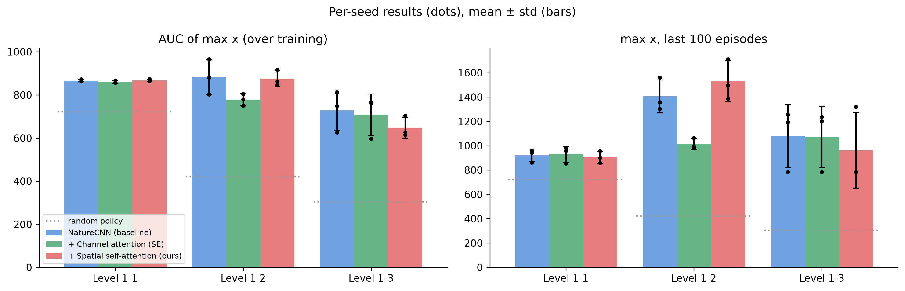
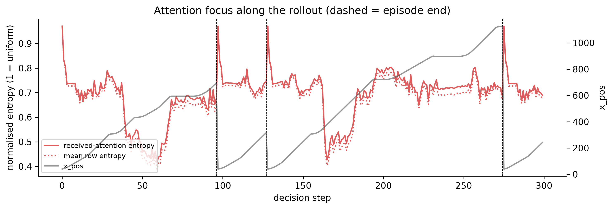
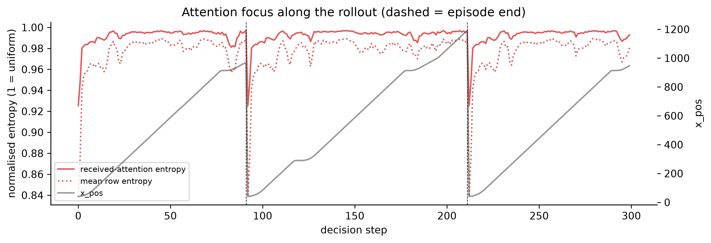
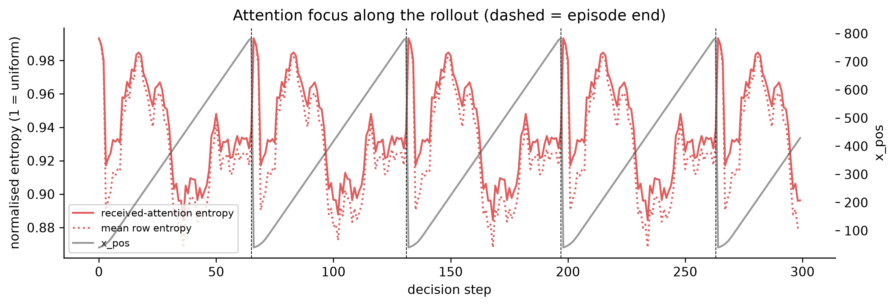
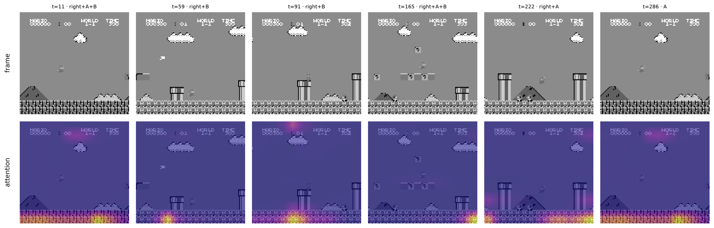
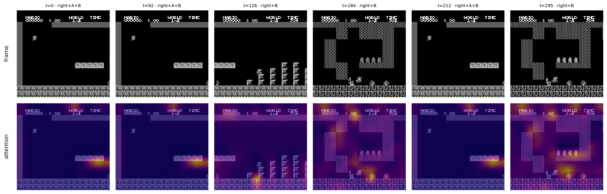
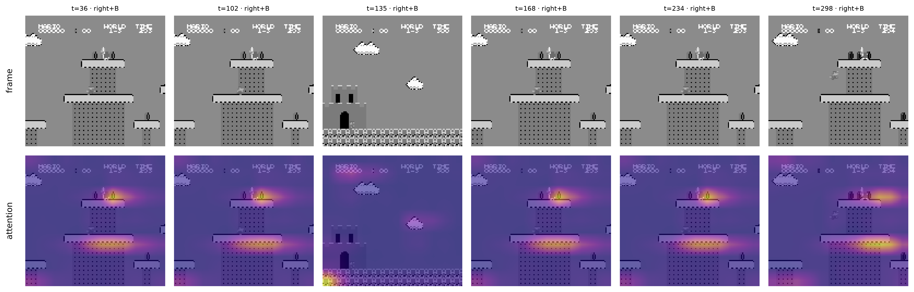
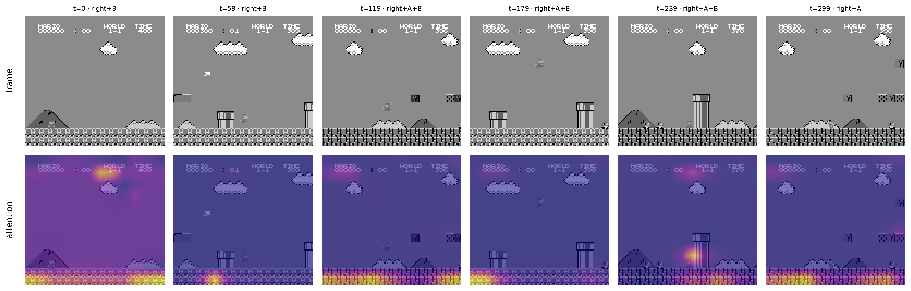
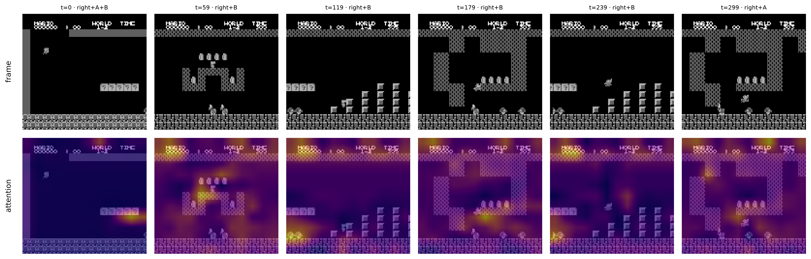
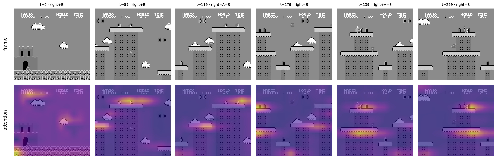
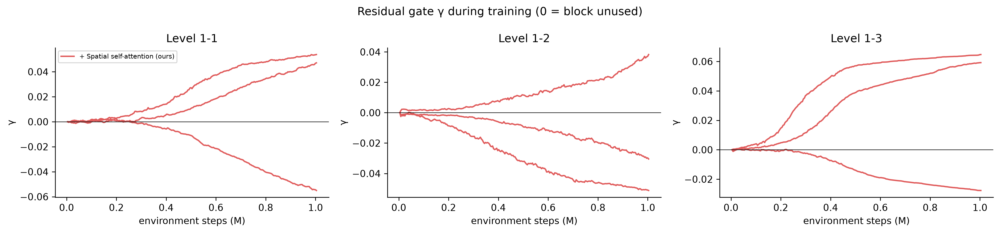
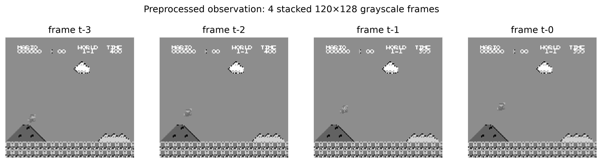
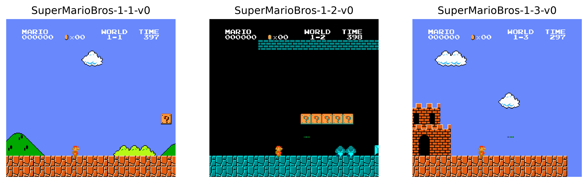
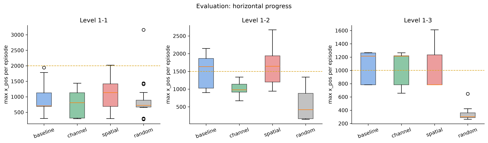
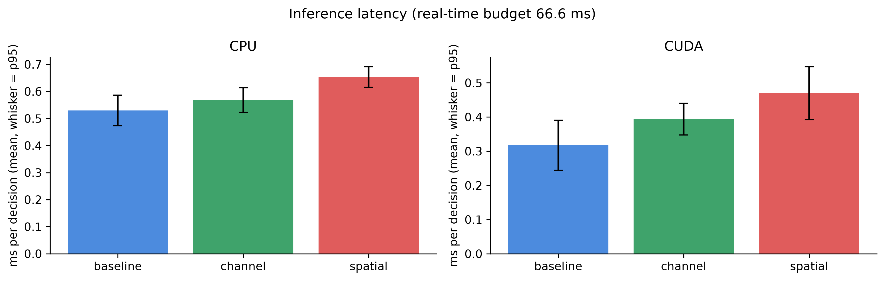
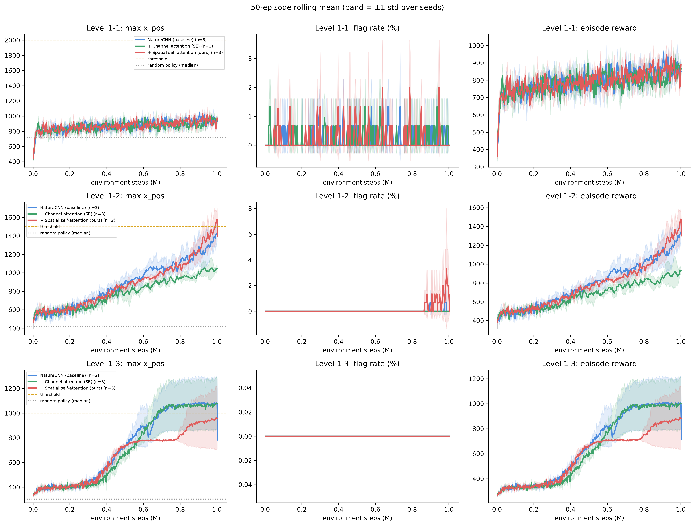
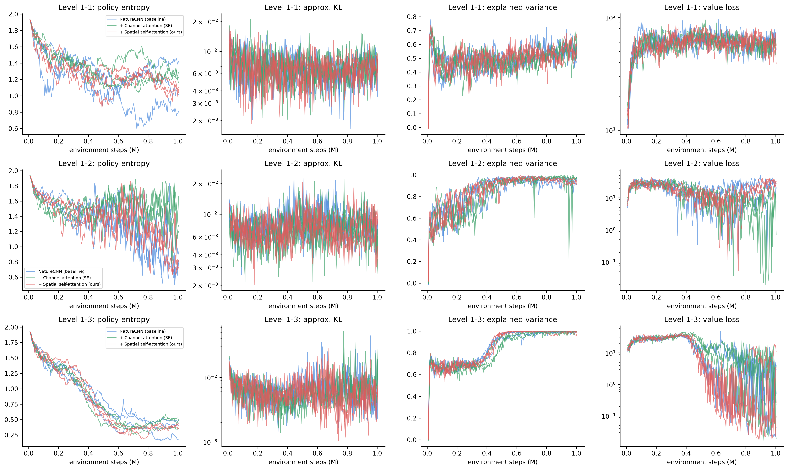

## Animations

