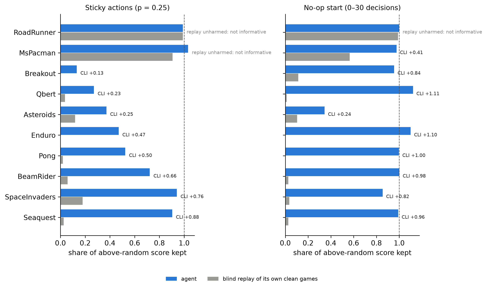
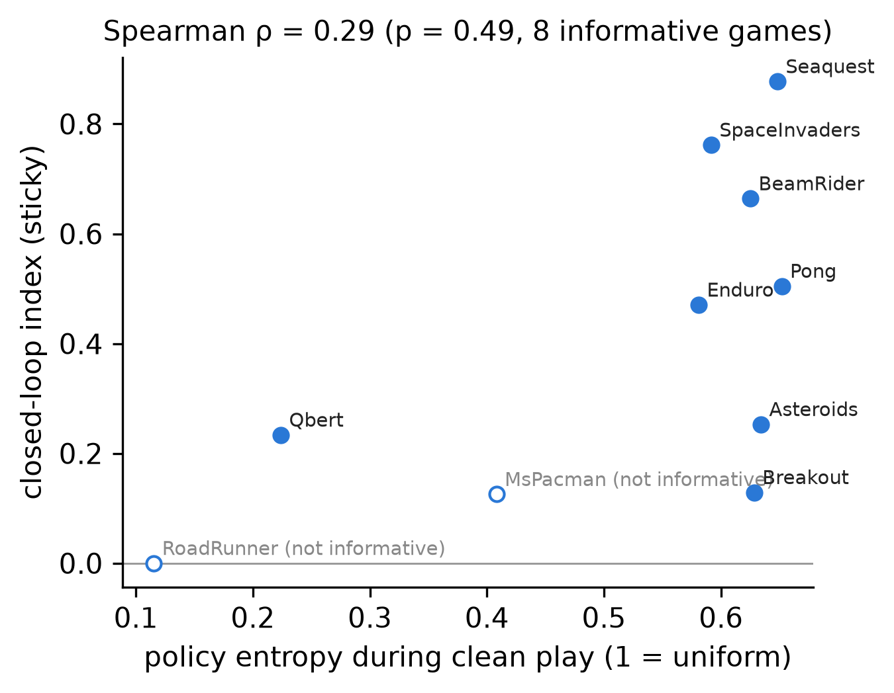

# Closed-loop index on published Atari PPO agents

Generated 2026-11-03 01:53 · 10 games · 10 episodes per condition

- **RoadRunner**: sticky CLI +0.00 [+0.00, +0.00] (agent kept 0.99, tape kept 0.99, Holm p 1.000); no-op CLI +0.01; entropy 0.12 — sticky not informative (tape unharmed)
- **MsPacman**: sticky CLI +0.13 [+0.06, +0.22] (agent kept 1.03, tape kept 0.91, Holm p 0.020); no-op CLI +0.41; entropy 0.41 — sticky not informative (tape unharmed)
- **Breakout**: sticky CLI +0.13 [+0.07, +0.22] (agent kept 0.13, tape kept 0.00, Holm p 0.020); no-op CLI +0.84; entropy 0.63
- **Qbert**: sticky CLI +0.23 [+0.09, +0.39] (agent kept 0.27, tape kept 0.04, Holm p 0.020); no-op CLI +1.11; entropy 0.22
- **Asteroids**: sticky CLI +0.25 [-0.20, +0.67] (agent kept 0.37, tape kept 0.12, Holm p 0.445); no-op CLI +0.24; entropy 0.63
- **Enduro**: sticky CLI +0.47 [+0.37, +0.57] (agent kept 0.47, tape kept 0.00, Holm p 0.020); no-op CLI +1.10; entropy 0.58
- **Pong**: sticky CLI +0.50 [+0.42, +0.58] (agent kept 0.52, tape kept 0.02, Holm p 0.020); no-op CLI +1.00; entropy 0.65
- **BeamRider**: sticky CLI +0.66 [+0.47, +0.86] (agent kept 0.72, tape kept 0.06, Holm p 0.020); no-op CLI +0.98; entropy 0.63
- **SpaceInvaders**: sticky CLI +0.76 [+0.42, +1.14] (agent kept 0.94, tape kept 0.18, Holm p 0.020); no-op CLI +0.82; entropy 0.59
- **Seaquest**: sticky CLI +0.88 [+0.83, +0.93] (agent kept 0.90, tape kept 0.03, Holm p 0.020); no-op CLI +0.96; entropy 0.65

Entropy vs. sticky CLI across informative games: Spearman ρ = 0.29 (p = 0.49)

### Published PPO agents audited (RL Zoo, Hugging Face)

| Game | Actions | Lives-based episodes | FIRE on reset | Policy params |
|:---|---:|---:|---:|---:|
| Pong | 6 | True | True | 1687719 |
| Breakout | 4 | True | True | 1686693 |
| SpaceInvaders | 6 | True | True | 1687719 |
| Qbert | 6 | True | True | 1687719 |
| Seaquest | 18 | True | True | 1693875 |
| BeamRider | 9 | True | True | 1689258 |
| Enduro | 9 | True | True | 1689258 |
| MsPacman | 9 | True | False | 1689258 |
| Asteroids | 14 | True | True | 1691823 |
| RoadRunner | 18 | True | True | 1693875 |

### Blind replay of each clean game's button tape (must be 100% for the CLI to be valid)

| Game | Episodes | Reproduced exactly |
|:---|---:|---:|
| Asteroids | 10 | 100% |
| BeamRider | 10 | 100% |
| Breakout | 10 | 100% |
| Enduro | 10 | 100% |
| MsPacman | 10 | 100% |
| Pong | 10 | 100% |
| Qbert | 10 | 100% |
| RoadRunner | 10 | 100% |
| Seaquest | 10 | 100% |
| SpaceInvaders | 10 | 100% |

### Closed-loop index per game (kept = share of above-random score; CLI = agent kept − tape kept)

| Game | Random | Clean | Entropy | sticky: agent kept | sticky: tape kept | sticky: CLI | sticky: CI low | sticky: CI high | sticky: p | sticky: informative | noop: agent kept | noop: tape kept | noop: CLI | noop: CI low | noop: CI high | noop: p | noop: informative | sticky: p (Holm) | noop: p (Holm) |
|:---|---:|---:|---:|---:|---:|---:|---:|---:|---:|---:|---:|---:|---:|---:|---:|---:|---:|---:|---:|
| RoadRunner | 0.00 | 980.00 | 0.12 | 0.99 | 0.99 | 0.00 | 0.00 | 0.00 | 1.00 | False | 1.00 | 0.99 | 0.01 | 0.00 | 0.03 | 1.00 | False | 1.00 | 1.00 |
| MsPacman | 226.00 | 1,763.00 | 0.41 | 1.03 | 0.91 | 0.13 | 0.06 | 0.22 | 0.00 | False | 0.98 | 0.57 | 0.41 | 0.28 | 0.54 | 0.00 | True | 0.02 | 0.02 |
| Breakout | 1.30 | 362.30 | 0.63 | 0.13 | 0.00 | 0.13 | 0.07 | 0.22 | 0.00 | True | 0.96 | 0.11 | 0.84 | 0.55 | 1.07 | 0.00 | True | 0.02 | 0.02 |
| Qbert | 105.00 | 13,962.50 | 0.22 | 0.27 | 0.04 | 0.23 | 0.09 | 0.39 | 0.00 | True | 1.12 | 0.01 | 1.11 | 1.01 | 1.21 | 0.00 | True | 0.02 | 0.02 |
| Asteroids | 1,105.00 | 2,378.00 | 0.63 | 0.37 | 0.12 | 0.25 | -0.20 | 0.67 | 0.22 | True | 0.34 | 0.10 | 0.24 | -0.13 | 0.66 | 0.56 | True | 0.45 | 1.00 |
| Enduro | 0.00 | 895.60 | 0.58 | 0.47 | 0.00 | 0.47 | 0.37 | 0.57 | 0.00 | True | 1.10 | 0.00 | 1.10 | 1.02 | 1.17 | 0.00 | True | 0.02 | 0.02 |
| Pong | -20.40 | 21.00 | 0.65 | 0.52 | 0.02 | 0.50 | 0.42 | 0.58 | 0.00 | True | 1.00 | 0.00 | 1.00 | 0.99 | 1.00 | 0.00 | True | 0.02 | 0.02 |
| BeamRider | 382.80 | 3,453.00 | 0.63 | 0.72 | 0.06 | 0.66 | 0.47 | 0.86 | 0.00 | True | 1.00 | 0.03 | 0.98 | 0.72 | 1.22 | 0.00 | True | 0.02 | 0.02 |
| SpaceInvaders | 164.00 | 924.00 | 0.59 | 0.94 | 0.18 | 0.76 | 0.42 | 1.14 | 0.00 | True | 0.86 | 0.03 | 0.82 | 0.57 | 1.08 | 0.00 | True | 0.02 | 0.02 |
| Seaquest | 58.00 | 1,756.00 | 0.65 | 0.90 | 0.03 | 0.88 | 0.83 | 0.93 | 0.00 | True | 0.99 | 0.03 | 0.96 | 0.91 | 1.01 | 0.00 | True | 0.02 | 0.02 |

## Figures

