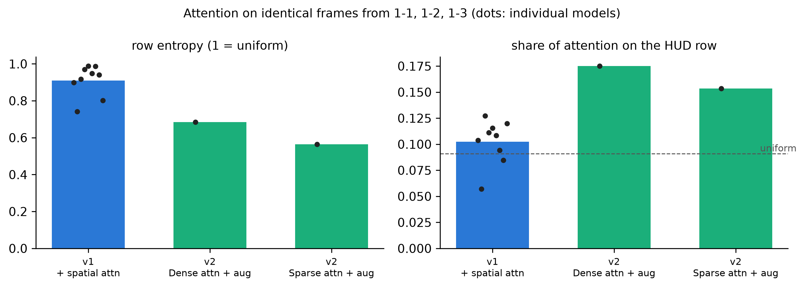
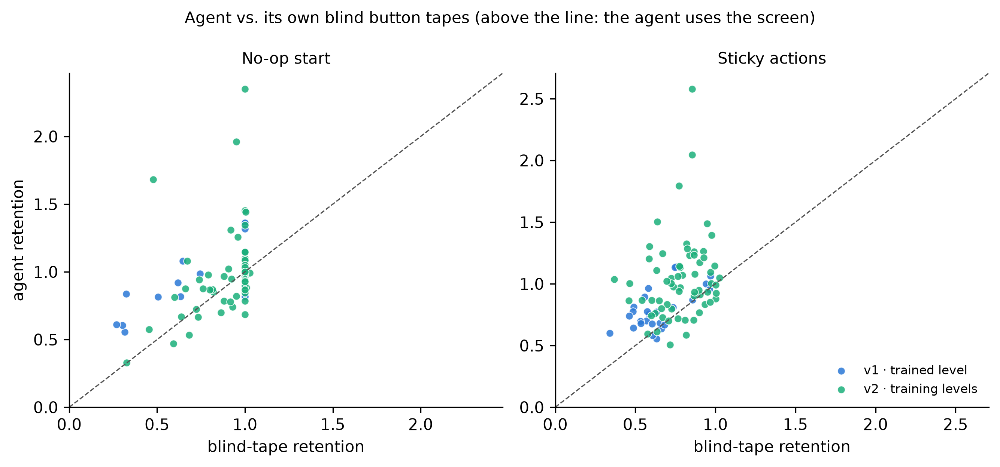
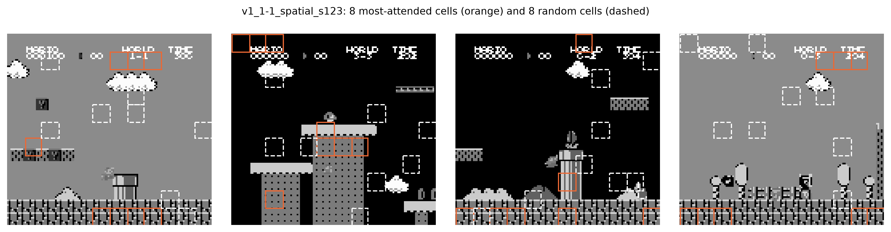
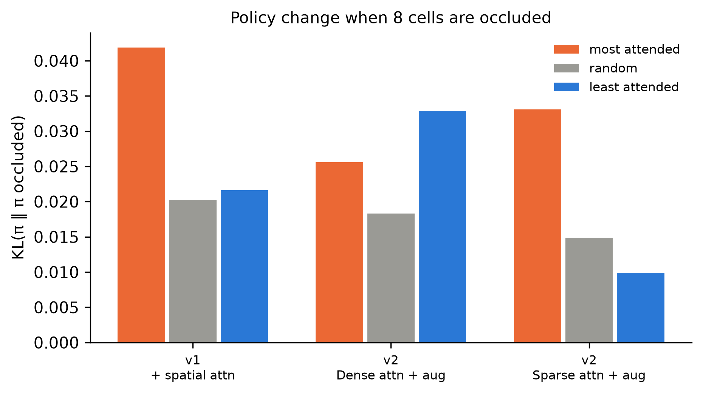
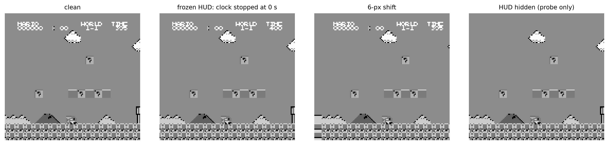
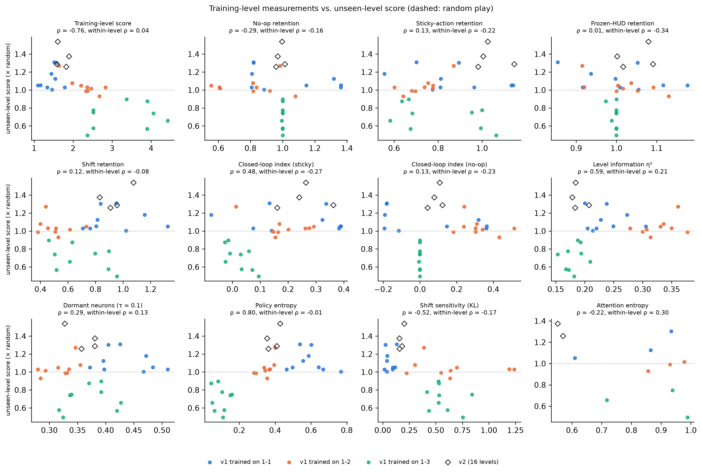
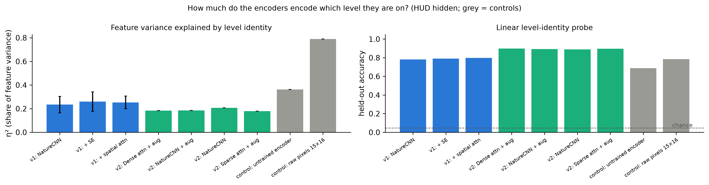
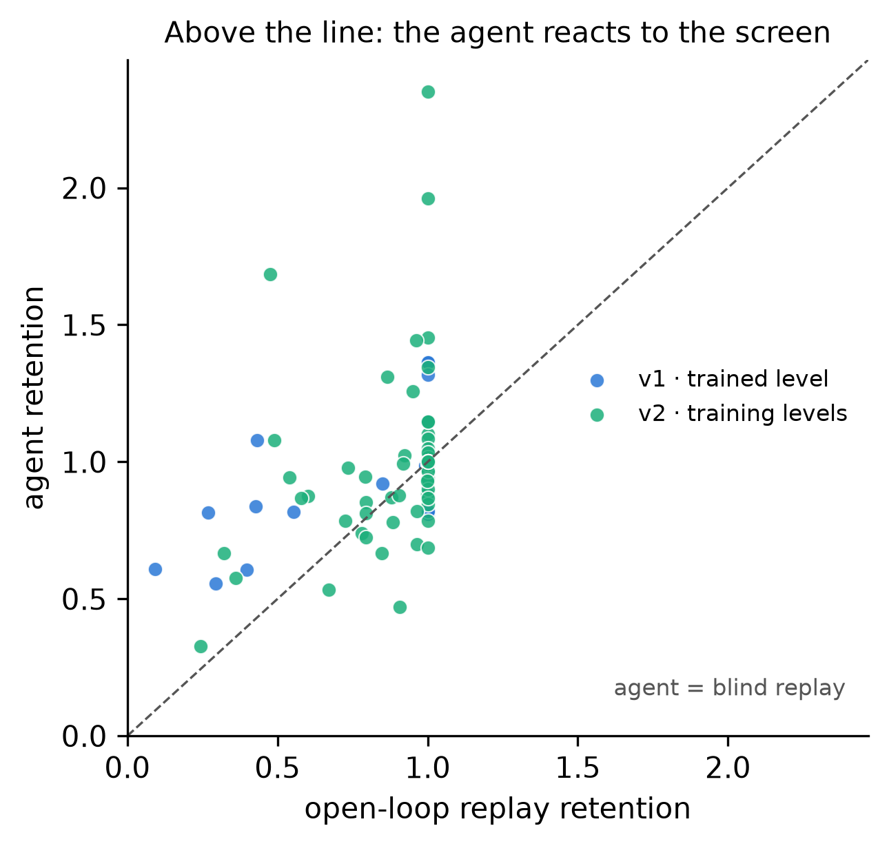
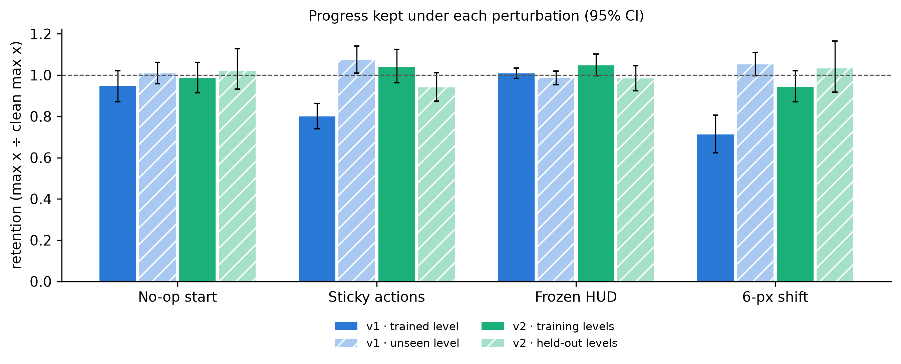
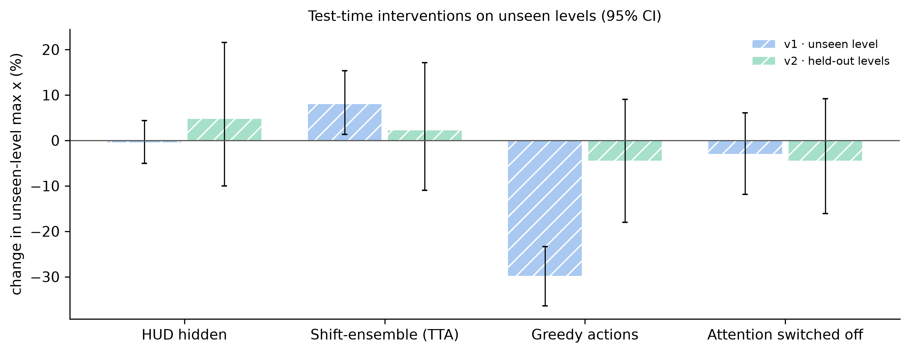

# Diagnostic audit of pixel-based PPO agents on Super Mario Bros.

Generated 2026-11-02 00:58 · 31 models · levels ['1-1', '1-2', '1-3', '2-3', '3-1', '3-3', '4-1', '4-3', '5-1', '5-2', '6-1', '6-2', '6-3', '7-1', '7-3', '8-2', '8-3', '2-1', '3-2', '4-2', '5-3', '8-1']

## Key numbers

- **v1 · trained level** (n = 27): clean score 2.35× random; retention no-op start 0.95, sticky actions 0.80, frozen hud 1.01, 6-px shift 0.71.
- **v1 · unseen level** (n = 54): clean score 0.96× random; retention no-op start 1.01, sticky actions 1.07, frozen hud 0.99, 6-px shift 1.05.
- **v2 · training levels** (n = 64): clean score 1.73× random; retention no-op start 0.99, sticky actions 1.04, frozen hud 1.05, 6-px shift 0.94.
- **v2 · held-out levels** (n = 24): clean score 1.36× random; retention no-op start 1.02, sticky actions 0.94, frozen hud 0.98, 6-px shift 1.03.
- **v1 · trained level, no-op starts**: agent keeps 0.95 of its clean progress, its blind replay 0.83; agent ahead in 48% of 27 cases.
- **v2 · training levels, no-op starts**: agent keeps 0.99 of its clean progress, its blind replay 0.89; agent ahead in 56% of 64 cases.
- **v1 · trained level, closed-loop index**: sticky +0.15 (agent 0.80 vs tape 0.65), no-op +0.12.
- **v2 · training levels, closed-loop index**: sticky +0.26 (agent 1.04 vs tape 0.78), no-op +0.09.
- Level information, v1 baseline: η² 0.234, probe accuracy 0.78 (HUD hidden; chance 0.05).
- Level information, v1 channel: η² 0.259, probe accuracy 0.79 (HUD hidden; chance 0.05).
- Level information, v1 spatial: η² 0.253, probe accuracy 0.80 (HUD hidden; chance 0.05).
- Level information, v2 attn_aug: η² 0.183, probe accuracy 0.90 (HUD hidden; chance 0.05).
- Level information, v2 cnn_aug: η² 0.184, probe accuracy 0.89 (HUD hidden; chance 0.05).
- Level information, v2 cnn: η² 0.207, probe accuracy 0.89 (HUD hidden; chance 0.05).
- Level information, v2 sparse_aug: η² 0.179, probe accuracy 0.90 (HUD hidden; chance 0.05).
- Level information, control untrained: η² 0.363, probe accuracy 0.69 (HUD hidden; chance 0.05).
- Level information, control pixels: η² 0.789, probe accuracy 0.78 (HUD hidden; chance 0.05).
- Attention, v1 spatial: row entropy 0.91, HUD share 0.10.
- Attention, v2 attn_aug: row entropy 0.69, HUD share 0.18.
- Attention, v2 sparse_aug: row entropy 0.56, HUD share 0.15.
- Occlusion, v1 spatial: KL top-8 0.0419 vs random 0.0202 (top > random on 51% of frames).
- Occlusion, v2 attn_aug: KL top-8 0.0256 vs random 0.0183 (top > random on 44% of frames).
- Occlusion, v2 sparse_aug: KL top-8 0.0331 vs random 0.0149 (top > random on 59% of frames).
- Test-time hud hidden, v1 · unseen level: unseen-level change -0.4% (-5.0%–+4.4%), improved in 43% of 54 (Holm p = 1.000).
- Test-time shift-ensemble (tta), v1 · unseen level: unseen-level change +8.0% (+1.3%–+15.3%), improved in 52% of 54 (Holm p = 1.000).
- Test-time greedy actions, v1 · unseen level: unseen-level change -29.8% (-36.4%–-23.4%), improved in 13% of 54 (Holm p = 0.000).
- Test-time attention switched off, v1 · unseen level: unseen-level change -3.0% (-11.9%–+6.1%), improved in 50% of 18 (Holm p = 1.000).
- Test-time hud hidden, v2 · held-out levels: unseen-level change +4.8% (-10.0%–+21.6%), improved in 42% of 24 (Holm p = 1.000).
- Test-time shift-ensemble (tta), v2 · held-out levels: unseen-level change +2.2% (-11.0%–+17.1%), improved in 38% of 24 (Holm p = 1.000).
- Test-time greedy actions, v2 · held-out levels: unseen-level change -4.4% (-18.0%–+9.0%), improved in 38% of 24 (Holm p = 1.000).
- Test-time attention switched off, v2 · held-out levels: unseen-level change -4.5% (-16.1%–+9.2%), improved in 25% of 12 (Holm p = 1.000).
- Predictor of transfer, Policy entropy: ρ = 0.80 (0.59 to 0.91), within-level ρ = -0.01 (Holm p = 0.000).
- Predictor of transfer, Training-level score: ρ = -0.76 (-0.87 to -0.58), within-level ρ = 0.04 (Holm p = 0.000).
- Predictor of transfer, Level information η²: ρ = 0.59 (0.19 to 0.80), within-level ρ = 0.21 (Holm p = 0.012).
- Predictor of transfer, Shift sensitivity (KL): ρ = -0.52 (-0.71 to -0.18), within-level ρ = -0.17 (Holm p = 0.054).

### Checkpoints audited

| model | family | variant | seed | trained_on | block | gamma | final | checkpoint |
|:---|---:|---:|---:|---:|---:|---:|---:|---:|
| v1_1-1_baseline_s123 | v1 | baseline | 123 | 1-1 | none | – | yes | 1-1_baseline_s123_final.zip |
| v1_1-1_baseline_s42 | v1 | baseline | 42 | 1-1 | none | – | yes | 1-1_baseline_s42_final.zip |
| v1_1-1_baseline_s777 | v1 | baseline | 777 | 1-1 | none | – | yes | 1-1_baseline_s777_final.zip |
| v1_1-1_channel_s123 | v1 | channel | 123 | 1-1 | SEBlock | – | yes | 1-1_channel_s123_final.zip |
| v1_1-1_channel_s42 | v1 | channel | 42 | 1-1 | SEBlock | – | yes | 1-1_channel_s42_final.zip |
| v1_1-1_channel_s777 | v1 | channel | 777 | 1-1 | SEBlock | – | yes | 1-1_channel_s777_final.zip |
| v1_1-1_spatial_s123 | v1 | spatial | 123 | 1-1 | SpatialSelfAttention | 0.0552 | yes | 1-1_spatial_s123_final.zip |
| v1_1-1_spatial_s42 | v1 | spatial | 42 | 1-1 | SpatialSelfAttention | 0.0537 | yes | 1-1_spatial_s42_final.zip |
| v1_1-1_spatial_s777 | v1 | spatial | 777 | 1-1 | SpatialSelfAttention | 0.0471 | yes | 1-1_spatial_s777_final.zip |
| v1_1-2_baseline_s123 | v1 | baseline | 123 | 1-2 | none | – | yes | 1-2_baseline_s123_final.zip |
| v1_1-2_baseline_s42 | v1 | baseline | 42 | 1-2 | none | – | yes | 1-2_baseline_s42_final.zip |
| v1_1-2_baseline_s777 | v1 | baseline | 777 | 1-2 | none | – | yes | 1-2_baseline_s777_final.zip |
| v1_1-2_channel_s123 | v1 | channel | 123 | 1-2 | SEBlock | – | yes | 1-2_channel_s123_final.zip |
| v1_1-2_channel_s42 | v1 | channel | 42 | 1-2 | SEBlock | – | yes | 1-2_channel_s42_final.zip |
| v1_1-2_channel_s777 | v1 | channel | 777 | 1-2 | SEBlock | – | yes | 1-2_channel_s777_final.zip |
| v1_1-2_spatial_s123 | v1 | spatial | 123 | 1-2 | SpatialSelfAttention | 0.0393 | yes | 1-2_spatial_s123_final.zip |
| v1_1-2_spatial_s42 | v1 | spatial | 42 | 1-2 | SpatialSelfAttention | 0.0306 | yes | 1-2_spatial_s42_final.zip |
| v1_1-2_spatial_s777 | v1 | spatial | 777 | 1-2 | SpatialSelfAttention | 0.0511 | yes | 1-2_spatial_s777_final.zip |
| v1_1-3_baseline_s123 | v1 | baseline | 123 | 1-3 | none | – | yes | 1-3_baseline_s123_final.zip |
| v1_1-3_baseline_s42 | v1 | baseline | 42 | 1-3 | none | – | yes | 1-3_baseline_s42_final.zip |
| v1_1-3_baseline_s777 | v1 | baseline | 777 | 1-3 | none | – | yes | 1-3_baseline_s777_final.zip |
| v1_1-3_channel_s123 | v1 | channel | 123 | 1-3 | SEBlock | – | yes | 1-3_channel_s123_final.zip |
| v1_1-3_channel_s42 | v1 | channel | 42 | 1-3 | SEBlock | – | yes | 1-3_channel_s42_final.zip |
| v1_1-3_channel_s777 | v1 | channel | 777 | 1-3 | SEBlock | – | yes | 1-3_channel_s777_final.zip |
| v1_1-3_spatial_s123 | v1 | spatial | 123 | 1-3 | SpatialSelfAttention | 0.0278 | yes | 1-3_spatial_s123_final.zip |
| v1_1-3_spatial_s42 | v1 | spatial | 42 | 1-3 | SpatialSelfAttention | 0.0648 | yes | 1-3_spatial_s42_final.zip |
| v1_1-3_spatial_s777 | v1 | spatial | 777 | 1-3 | SpatialSelfAttention | 0.0596 | yes | 1-3_spatial_s777_final.zip |
| v2_attn_aug_s42 | v2 | attn_aug | 42 | 16 levels | SpatialSelfAttention | 0.0946 | yes | attn_aug_s42_final.zip |
| v2_cnn_aug_s42 | v2 | cnn_aug | 42 | 16 levels | none | – | yes | cnn_aug_s42_final.zip |
| v2_cnn_s42 | v2 | cnn | 42 | 16 levels | none | – | yes | cnn_s42_final.zip |
| v2_sparse_aug_s42 | v2 | sparse_aug | 42 | 16 levels | SparsePositionalAttention | 0.1260 | yes | sparse_aug_s42_final.zip |

### Clean score and retention under each perturbation (mean, 95% bootstrap CI over model × level; 1.0 = unaffected)

| Group | n (model × level) | Clean score (× random) | No-op start | Sticky actions | Frozen HUD | 6-px shift |
|:---|---:|---:|---:|---:|---:|---:|
| v1 · trained level | 27 | 2.35 (2.02–2.70) | 0.95 (0.87–1.02) | 0.80 (0.74–0.86) | 1.01 (0.98–1.03) | 0.71 (0.62–0.81) |
| v1 · unseen level | 54 | 0.96 (0.88–1.03) | 1.01 (0.96–1.06) | 1.07 (1.01–1.14) | 0.99 (0.95–1.02) | 1.05 (1.00–1.11) |
| v2 · training levels | 64 | 1.73 (1.56–1.90) | 0.99 (0.91–1.06) | 1.04 (0.96–1.12) | 1.05 (1.00–1.10) | 0.94 (0.87–1.02) |
| v2 · held-out levels | 24 | 1.36 (1.22–1.52) | 1.02 (0.93–1.13) | 0.94 (0.87–1.01) | 0.98 (0.92–1.05) | 1.03 (0.92–1.17) |

### Perturbation vs clean max x, paired over model × level (Holm over all rows)

| Group | Condition | n | Mean retention | Units below 0.9 | p (Wilcoxon vs clean) | p (Holm) |
|:---|---:|---:|---:|---:|---:|---:|
| v1 · trained level | No-op start | 27 | 0.946 | 41% | 0.092 | 1.000 |
| v1 · trained level | Sticky actions | 27 | 0.799 | 74% | 0.000 | 0.001 |
| v1 · trained level | Frozen HUD | 27 | 1.009 | 4% | 0.476 | 1.000 |
| v1 · trained level | 6-px shift | 27 | 0.712 | 81% | 0.000 | 0.000 |
| v1 · unseen level | No-op start | 54 | 1.009 | 28% | 0.614 | 1.000 |
| v1 · unseen level | Sticky actions | 54 | 1.073 | 15% | 0.154 | 1.000 |
| v1 · unseen level | Frozen HUD | 54 | 0.987 | 17% | 0.372 | 1.000 |
| v1 · unseen level | 6-px shift | 54 | 1.051 | 20% | 0.477 | 1.000 |
| v2 · training levels | No-op start | 64 | 0.985 | 38% | 0.062 | 0.747 |
| v2 · training levels | Sticky actions | 64 | 1.040 | 34% | 0.836 | 1.000 |
| v2 · training levels | Frozen HUD | 64 | 1.047 | 11% | 0.146 | 1.000 |
| v2 · training levels | 6-px shift | 64 | 0.943 | 42% | 0.009 | 0.133 |
| v2 · held-out levels | No-op start | 24 | 1.020 | 38% | 0.638 | 1.000 |
| v2 · held-out levels | Sticky actions | 24 | 0.940 | 42% | 0.031 | 0.409 |
| v2 · held-out levels | Frozen HUD | 24 | 0.985 | 21% | 0.557 | 1.000 |
| v2 · held-out levels | 6-px shift | 24 | 1.033 | 33% | 0.456 | 1.000 |

### Clean score and mean retention per variant

| Group | Variant | Models | Clean score | No-op start | Sticky actions | Frozen HUD | 6-px shift |
|:---|---:|---:|---:|---:|---:|---:|---:|
| v1 · trained level | + SE | 9 | 2.19 | 1.02 | 0.80 | 0.99 | 0.64 |
| v1 · trained level | + spatial attn | 9 | 2.34 | 0.99 | 0.84 | 1.05 | 0.78 |
| v1 · trained level | NatureCNN | 9 | 2.51 | 0.83 | 0.76 | 0.99 | 0.72 |
| v1 · unseen level | + SE | 9 | 0.98 | 1.04 | 1.06 | 1.05 | 1.08 |
| v1 · unseen level | + spatial attn | 9 | 0.92 | 0.97 | 1.13 | 0.95 | 1.06 |
| v1 · unseen level | NatureCNN | 9 | 0.96 | 1.02 | 1.02 | 0.97 | 1.01 |
| v2 · training levels | Dense attn + aug | 1 | 1.82 | 0.96 | 0.98 | 1.02 | 0.91 |
| v2 · training levels | NatureCNN | 1 | 1.58 | 1.01 | 1.15 | 1.09 | 0.96 |
| v2 · training levels | NatureCNN + aug | 1 | 1.61 | 1.00 | 1.03 | 1.08 | 1.08 |
| v2 · training levels | Sparse attn + aug | 1 | 1.90 | 0.97 | 1.01 | 1.00 | 0.83 |
| v2 · held-out levels | Dense attn + aug | 1 | 1.26 | 1.02 | 0.95 | 1.03 | 0.99 |
| v2 · held-out levels | NatureCNN | 1 | 1.29 | 1.17 | 0.92 | 1.04 | 1.23 |
| v2 · held-out levels | NatureCNN + aug | 1 | 1.54 | 0.96 | 0.94 | 0.98 | 1.00 |
| v2 · held-out levels | Sparse attn + aug | 1 | 1.37 | 0.93 | 0.95 | 0.88 | 0.91 |

### How episodes ended (share): death, stall (no progress for STALL_STEPS decisions), flag, end of replay

| Group | Condition | death | flag | replay_end | stall |
|:---|---:|---:|---:|---:|---:|
| v1 · trained level | Clean | 0.96 | 0.01 | 0.00 | 0.03 |
| v1 · trained level | No-op start | 0.99 | 0.00 | 0.00 | 0.01 |
| v1 · trained level | Sticky actions | 0.96 | 0.00 | 0.00 | 0.04 |
| v1 · trained level | Frozen HUD | 0.96 | 0.01 | 0.00 | 0.03 |
| v1 · trained level | 6-px shift | 0.97 | 0.00 | 0.00 | 0.03 |
| v1 · trained level | Open-loop replay + no-op start | 0.91 | 0.07 | 0.01 | 0.00 |
| v1 · unseen level | Clean | 0.92 | 0.00 | 0.00 | 0.08 |
| v1 · unseen level | No-op start | 0.94 | 0.00 | 0.00 | 0.06 |
| v1 · unseen level | Sticky actions | 0.94 | 0.00 | 0.00 | 0.06 |
| v1 · unseen level | Frozen HUD | 0.93 | 0.00 | 0.00 | 0.07 |
| v1 · unseen level | 6-px shift | 0.90 | 0.00 | 0.00 | 0.10 |
| v2 · training levels | Clean | 1.00 | 0.00 | 0.00 | 0.00 |
| v2 · training levels | No-op start | 0.99 | 0.00 | 0.00 | 0.01 |
| v2 · training levels | Sticky actions | 1.00 | 0.00 | 0.00 | 0.00 |
| v2 · training levels | Frozen HUD | 1.00 | 0.00 | 0.00 | 0.00 |
| v2 · training levels | 6-px shift | 0.99 | 0.00 | 0.00 | 0.01 |
| v2 · training levels | Open-loop replay + no-op start | 0.93 | 0.00 | 0.07 | 0.00 |
| v2 · held-out levels | Clean | 0.99 | 0.00 | 0.00 | 0.01 |
| v2 · held-out levels | No-op start | 1.00 | 0.00 | 0.00 | 0.00 |
| v2 · held-out levels | Sticky actions | 0.99 | 0.00 | 0.00 | 0.01 |
| v2 · held-out levels | Frozen HUD | 1.00 | 0.00 | 0.00 | 0.00 |
| v2 · held-out levels | 6-px shift | 0.99 | 0.00 | 0.00 | 0.01 |

### Agent vs. blind replay of its own best episode, both with no-op starts (retention = share of clean progress kept)

| Group | Variant | n | Agent retention (no-op) | Open-loop replay retention (no-op) | Agent − replay | Agent > replay | p (Wilcoxon) |
|:---|---:|---:|---:|---:|---:|---:|---:|
| v1 · trained level | all | 27 | 0.95 | 0.83 | 0.12 | 48% | 0.03 |
| v2 · training levels | all | 64 | 0.99 | 0.89 | 0.10 | 56% | 0.05 |
| v1 · trained level | NatureCNN | 9 | 0.83 | 0.79 | 0.04 | 33% | 0.44 |
| v1 · trained level | + SE | 9 | 1.02 | 0.87 | 0.15 | 56% | 0.20 |
| v1 · trained level | + spatial attn | 9 | 0.99 | 0.82 | 0.17 | 56% | 0.16 |
| v2 · training levels | Dense attn + aug | 16 | 0.96 | 0.90 | 0.06 | 75% | 0.14 |
| v2 · training levels | NatureCNN | 16 | 1.01 | 0.88 | 0.13 | 50% | 0.31 |
| v2 · training levels | NatureCNN + aug | 16 | 1.00 | 0.88 | 0.11 | 62% | 0.11 |
| v2 · training levels | Sparse attn + aug | 16 | 0.97 | 0.88 | 0.09 | 38% | 0.43 |

### Closed-loop index: agent retention − blind-tape retention under the same perturbation (mean, 95% CI)

| Group | Variant | n | No-op: agent | No-op: tape | No-op: CLI | No-op: p | Sticky: agent | Sticky: tape | Sticky: CLI | Sticky: p | No-op: p (Holm) | Sticky: p (Holm) |
|:---|---:|---:|---:|---:|---:|---:|---:|---:|---:|---:|---:|---:|
| v1 · trained level | all | 27 | 0.95 | 0.83 | 0.12 (0.04–0.20) | 0.01 | 0.80 | 0.65 | 0.15 (0.10–0.20) | 0.00 | 0.08 | 0.00 |
| v2 · training levels | all | 64 | 0.99 | 0.90 | 0.09 (0.02–0.16) | 0.14 | 1.04 | 0.78 | 0.26 (0.18–0.34) | 0.00 | 0.87 | 0.00 |
| v1 · trained level | NatureCNN | 9 | 0.83 | 0.77 | 0.06 (-0.07–0.22) | 0.44 | 0.76 | 0.59 | 0.17 (0.08–0.25) | 0.01 | 1.00 | 0.05 |
| v1 · trained level | + SE | 9 | 1.02 | 0.88 | 0.14 (0.02–0.26) | 0.05 | 0.80 | 0.70 | 0.09 (0.02–0.18) | 0.07 | 0.44 | 0.07 |
| v1 · trained level | + spatial attn | 9 | 0.99 | 0.84 | 0.15 (0.02–0.28) | 0.11 | 0.84 | 0.66 | 0.18 (0.09–0.27) | 0.02 | 0.77 | 0.05 |
| v2 · training levels | Dense attn + aug | 16 | 0.96 | 0.92 | 0.04 (-0.03–0.12) | 0.27 | 0.98 | 0.82 | 0.16 (0.07–0.26) | 0.01 | 1.00 | 0.05 |
| v2 · training levels | NatureCNN | 16 | 1.01 | 0.89 | 0.12 (-0.02–0.29) | 0.17 | 1.15 | 0.78 | 0.36 (0.18–0.60) | 0.00 | 0.87 | 0.00 |
| v2 · training levels | NatureCNN + aug | 16 | 1.00 | 0.89 | 0.11 (-0.01–0.30) | 0.45 | 1.03 | 0.76 | 0.26 (0.11–0.43) | 0.01 | 1.00 | 0.04 |
| v2 · training levels | Sparse attn + aug | 16 | 0.97 | 0.89 | 0.08 (-0.05–0.26) | 0.97 | 1.01 | 0.77 | 0.24 (0.09–0.42) | 0.02 | 1.00 | 0.05 |

### Level information in encoder features on shared frames (22 levels; probe chance 0.05; folds split by episode)

| Family | Encoder | Models | Level-explained variance η² | ± sd | Probe accuracy, HUD hidden | Probe accuracy, HUD visible |
|:---|---:|---:|---:|---:|---:|---:|
| v1 | NatureCNN | 9 | 0.234 | 0.070 | 0.781 | 0.831 |
| v1 | + SE | 9 | 0.259 | 0.082 | 0.791 | 0.827 |
| v1 | + spatial attn | 9 | 0.253 | 0.053 | 0.799 | 0.832 |
| v2 | Dense attn + aug | 1 | 0.183 | – | 0.898 | 0.955 |
| v2 | NatureCNN + aug | 1 | 0.184 | – | 0.894 | 0.965 |
| v2 | NatureCNN | 1 | 0.207 | – | 0.889 | 0.981 |
| v2 | Sparse attn + aug | 1 | 0.179 | – | 0.897 | 0.957 |
| control | untrained encoder (control) | 1 | 0.363 | – | 0.689 | 0.811 |
| control | raw pixels 15×16 (control) | 1 | 0.789 | – | 0.785 | 0.820 |

### v2 models: level-explained variance vs. generalisation gap (Spearman ρ = -0.60, p = 0.40, n = 4)

| model | variant | seed | Level η² | Probe accuracy | Generalisation gap (train − held-out score) |
|:---|---:|---:|---:|---:|---:|
| v2_attn_aug_s42 | attn_aug | 42 | 0.183 | 0.898 | 0.566 |
| v2_cnn_aug_s42 | cnn_aug | 42 | 0.184 | 0.894 | 0.069 |
| v2_cnn_s42 | cnn | 42 | 0.207 | 0.889 | 0.296 |
| v2_sparse_aug_s42 | sparse_aug | 42 | 0.179 | 0.897 | 0.523 |

### Attention on identical frames from levels 1-1, 1-2, 1-3 (entropy normalised; 1 = uniform; uniform HUD share = 12/132)

| Model | Training levels | Seeds | Row entropy | Effective positions | HUD share | Row entropy, own level(s) | Row entropy, unseen | |γ| |
|:---|---:|---:|---:|---:|---:|---:|---:|---:|
| v1 + spatial attn | 1 | 3 | 0.910 | 95.216 | 0.102 | 0.869 | 0.931 | 0.048 |
| v2 Dense attn + aug | 16 | 1 | 0.685 | 37.536 | 0.175 | 0.726 | 0.603 | 0.095 |
| v2 Sparse attn + aug | 16 | 1 | 0.563 | 16.250 | 0.153 | 0.567 | 0.556 | 0.126 |

### Policy change (KL) when occluding the 8 most-attended, 8 random or 8 least-attended cells

| Model | Models | Frames | KL top-8 attended | KL random 8 | KL least-attended 8 | Top ÷ random | Frames top > random | p (Wilcoxon, frames) | p (Holm) |
|:---|---:|---:|---:|---:|---:|---:|---:|---:|---:|
| v1 + spatial attn | 9 | 5,940 | 0.0419 | 0.0202 | 0.0216 | 2.0702 | 51% | 0.1406 | 0.1406 |
| v2 Dense attn + aug | 1 | 660 | 0.0256 | 0.0183 | 0.0329 | 1.3972 | 44% | 0.0373 | 0.0747 |
| v2 Sparse attn + aug | 1 | 660 | 0.0331 | 0.0149 | 0.0099 | 2.2219 | 59% | 0.0000 | 0.0000 |

### Test-time interventions on unseen levels vs. clean play (change: mean, 95% CI over model × level)

| Group | Intervention | n | Clean score | Score with intervention | Change | Units improved | p (Wilcoxon) | p (Holm) |
|:---|---:|---:|---:|---:|---:|---:|---:|---:|
| v1 · unseen level | HUD hidden | 54 | 0.955 | 0.935 | -0.4% (-5.0%–+4.4%) | 43% | 0.352 | 1.000 |
| v1 · unseen level | Shift-ensemble (TTA) | 54 | 0.955 | 0.993 | +8.0% (+1.3%–+15.3%) | 52% | 0.272 | 1.000 |
| v1 · unseen level | Greedy actions | 54 | 0.955 | 0.670 | -29.8% (-36.4%–-23.4%) | 13% | 0.000 | 0.000 |
| v1 · unseen level | Attention switched off | 18 | 0.924 | 0.901 | -3.0% (-11.9%–+6.1%) | 50% | 0.734 | 1.000 |
| v2 · held-out levels | HUD hidden | 24 | 1.364 | 1.362 | +4.8% (-10.0%–+21.6%) | 42% | 0.648 | 1.000 |
| v2 · held-out levels | Shift-ensemble (TTA) | 24 | 1.364 | 1.322 | +2.2% (-11.0%–+17.1%) | 38% | 0.543 | 1.000 |
| v2 · held-out levels | Greedy actions | 24 | 1.364 | 1.223 | -4.4% (-18.0%–+9.0%) | 38% | 0.301 | 1.000 |
| v2 · held-out levels | Attention switched off | 12 | 1.316 | 1.243 | -4.5% (-16.1%–+9.2%) | 25% | 0.278 | 1.000 |

### Unseen-level score (× random) per variant and intervention

| Group | Variant | Clean score | HUD hidden | Shift-ensemble (TTA) | Greedy actions | Attention switched off |
|:---|---:|---:|---:|---:|---:|---:|
| v1 · unseen level | NatureCNN | 0.96 | 0.88 | 0.96 | 0.67 | – |
| v1 · unseen level | + SE | 0.98 | 0.98 | 1.05 | 0.67 | – |
| v1 · unseen level | + spatial attn | 0.92 | 0.94 | 0.97 | 0.67 | 0.90 |
| v2 · held-out levels | Dense attn + aug | 1.26 | 1.57 | 1.50 | 1.16 | 1.25 |
| v2 · held-out levels | NatureCNN | 1.29 | 1.26 | 1.03 | 1.23 | – |
| v2 · held-out levels | NatureCNN + aug | 1.54 | 1.50 | 1.46 | 1.51 | – |
| v2 · held-out levels | Sparse attn + aug | 1.37 | 1.11 | 1.29 | 0.99 | 1.24 |

### Do training-level measurements predict unseen-level score? (v1 models; Holm over measures)

| Measure (training levels) | n models | Spearman ρ | 95% CI | p | Within-level ρ | Within-level p | p (Holm) | Within-level p (Holm) |
|:---|---:|---:|---:|---:|---:|---:|---:|---:|
| Policy entropy | 27 | 0.802 | 0.59 to 0.91 | 0.000 | -0.010 | 0.961 | 0.000 | 1.000 |
| Training-level score | 27 | -0.762 | -0.87 to -0.58 | 0.000 | 0.044 | 0.828 | 0.000 | 1.000 |
| Level information η² | 27 | 0.589 | 0.19 to 0.80 | 0.001 | 0.207 | 0.300 | 0.012 | 1.000 |
| Shift sensitivity (KL) | 27 | -0.515 | -0.71 to -0.18 | 0.006 | -0.168 | 0.401 | 0.054 | 1.000 |
| Closed-loop index (sticky) | 27 | 0.482 | 0.09 to 0.81 | 0.011 | -0.272 | 0.170 | 0.088 | 1.000 |
| No-op retention | 27 | -0.293 | -0.62 to 0.09 | 0.137 | -0.161 | 0.423 | 0.962 | 1.000 |
| Dormant neurons (τ = 0.1) | 27 | 0.287 | -0.08 to 0.58 | 0.147 | 0.126 | 0.532 | 0.962 | 1.000 |
| Attention entropy | 9 | -0.217 | -0.84 to 0.72 | 0.576 | 0.300 | 0.433 | 1.000 | 1.000 |
| Sticky-action retention | 27 | 0.129 | -0.31 to 0.59 | 0.522 | -0.220 | 0.269 | 1.000 | 1.000 |
| Closed-loop index (no-op) | 27 | 0.125 | -0.28 to 0.59 | 0.534 | -0.226 | 0.257 | 1.000 | 1.000 |
| Shift retention | 27 | 0.117 | -0.32 to 0.53 | 0.560 | -0.082 | 0.683 | 1.000 | 1.000 |
| Frozen-HUD retention | 27 | 0.008 | -0.43 to 0.48 | 0.968 | -0.335 | 0.087 | 1.000 | 1.000 |

### Training-level measurements and unseen-level score for every model

| model | family | variant | seed | trained_on | unseen_score | train_score | ret_noop | ret_sticky | ret_hud_freeze | ret_shift | cli_sticky | cli_noop | eta2 | attn_entropy | dormant | policy_entropy | shift_kl |
|:---|---:|---:|---:|---:|---:|---:|---:|---:|---:|---:|---:|---:|---:|---:|---:|---:|---:|
| v1_1-1_baseline_s123 | v1 | baseline | 123 | 1-1 | 1.003 | 1.460 | 0.885 | 0.774 | 1.055 | 1.023 | 0.141 | -0.115 | 0.214 | – | 0.467 | 0.768 | 0.040 |
| v1_1-1_baseline_s42 | v1 | baseline | 42 | 1-1 | 1.029 | 1.784 | 0.807 | 0.964 | 1.009 | 0.761 | 0.383 | -0.193 | 0.220 | – | 0.397 | 0.464 | 0.093 |
| v1_1-1_baseline_s777 | v1 | baseline | 777 | 1-1 | 1.309 | 1.514 | 0.819 | 0.702 | 0.854 | 0.952 | 0.133 | -0.181 | 0.200 | – | 0.426 | 0.538 | 0.132 |
| v1_1-1_channel_s123 | v1 | channel | 123 | 1-1 | 1.180 | 1.441 | 0.809 | 0.556 | 0.937 | 1.158 | -0.076 | -0.191 | 0.273 | – | 0.472 | 0.587 | 0.043 |
| v1_1-1_channel_s42 | v1 | channel | 42 | 1-1 | 1.052 | 1.165 | 1.363 | 1.141 | 1.116 | 0.805 | 0.390 | 0.363 | 0.249 | – | 0.484 | 0.643 | 0.116 |
| v1_1-1_channel_s777 | v1 | channel | 777 | 1-1 | 1.029 | 1.334 | 1.362 | 0.810 | 0.916 | 0.708 | 0.075 | 0.362 | 0.205 | – | 0.510 | 0.668 | 0.016 |
| v1_1-1_spatial_s123 | v1 | spatial | 123 | 1-1 | 1.125 | 1.540 | 1.319 | 0.812 | 0.997 | 0.815 | 0.323 | 0.319 | 0.228 | 0.865 | 0.396 | 0.556 | 0.039 |
| v1_1-1_spatial_s42 | v1 | spatial | 42 | 1-1 | 1.051 | 1.099 | 1.147 | 1.133 | 1.177 | 1.326 | 0.387 | 0.147 | 0.305 | 0.610 | 0.372 | 0.497 | 0.096 |
| v1_1-1_spatial_s777 | v1 | spatial | 777 | 1-1 | 1.302 | 1.569 | 0.819 | 0.894 | 1.053 | 0.837 | 0.336 | -0.181 | 0.238 | 0.934 | 0.405 | 0.602 | 0.026 |
| v1_1-2_baseline_s123 | v1 | baseline | 123 | 1-2 | 1.049 | 2.204 | 0.556 | 0.777 | 1.004 | 0.732 | 0.292 | 0.240 | 0.331 | – | 0.315 | 0.339 | 0.698 |
| v1_1-2_baseline_s42 | v1 | baseline | 42 | 1-2 | 1.029 | 2.829 | 0.838 | 0.602 | 1.091 | 0.512 | 0.262 | 0.514 | 0.278 | – | 0.280 | 0.368 | 1.239 |
| v1_1-2_baseline_s777 | v1 | baseline | 777 | 1-2 | 1.031 | 2.364 | 0.607 | 0.739 | 0.920 | 0.455 | 0.277 | 0.304 | 0.350 | – | 0.335 | 0.372 | 1.191 |
| v1_1-2_channel_s123 | v1 | channel | 123 | 1-2 | 0.987 | 2.328 | 0.817 | 0.697 | 1.000 | 0.382 | 0.164 | 0.183 | 0.377 | – | 0.328 | 0.294 | 0.225 |
| v1_1-2_channel_s42 | v1 | channel | 42 | 1-2 | 1.078 | 1.976 | 0.816 | 0.755 | 1.037 | 0.400 | 0.168 | 0.310 | 0.336 | – | 0.355 | 0.395 | 0.304 |
| v1_1-2_channel_s777 | v1 | channel | 777 | 1-2 | 1.270 | 1.638 | 0.985 | 0.871 | 0.915 | 0.439 | 0.013 | 0.241 | 0.361 | – | 0.346 | 0.399 | 0.388 |
| v1_1-2_spatial_s123 | v1 | spatial | 123 | 1-2 | 0.992 | 2.376 | 0.920 | 0.680 | 1.053 | 0.507 | 0.147 | 0.303 | 0.300 | 0.930 | 0.332 | 0.282 | 0.550 |
| v1_1-2_spatial_s42 | v1 | spatial | 42 | 1-2 | 1.015 | 2.463 | 0.610 | 0.775 | 1.016 | 0.614 | 0.201 | 0.341 | 0.307 | 0.978 | 0.293 | 0.345 | 0.640 |
| v1_1-2_spatial_s777 | v1 | spatial | 777 | 1-2 | 0.929 | 2.676 | 1.079 | 0.641 | 1.130 | 0.530 | 0.154 | 0.432 | 0.313 | 0.857 | 0.284 | 0.356 | 0.633 |
| v1_1-3_baseline_s123 | v1 | baseline | 123 | 1-3 | 0.575 | 2.517 | 1.000 | 0.994 | 1.000 | 0.894 | 0.033 | 0.000 | 0.168 | – | 0.317 | 0.117 | 0.611 |
| v1_1-3_baseline_s42 | v1 | baseline | 42 | 1-3 | 0.874 | 3.905 | 1.000 | 0.636 | 0.974 | 0.631 | -0.027 | 0.000 | 0.193 | – | 0.371 | 0.044 | 0.530 |
| v1_1-3_baseline_s777 | v1 | baseline | 777 | 1-3 | 0.740 | 4.059 | 1.000 | 0.683 | 1.000 | 0.504 | 0.030 | 0.000 | 0.153 | – | 0.336 | 0.150 | 0.531 |
| v1_1-3_channel_s123 | v1 | channel | 123 | 1-3 | 0.776 | 2.517 | 1.000 | 1.000 | 1.000 | 0.897 | 0.059 | 0.000 | 0.171 | – | 0.392 | 0.105 | 0.417 |
| v1_1-3_channel_s42 | v1 | channel | 42 | 1-3 | 0.568 | 3.901 | 1.000 | 0.675 | 1.000 | 0.517 | 0.071 | -0.000 | 0.172 | – | 0.420 | 0.063 | 0.436 |
| v1_1-3_channel_s777 | v1 | channel | 777 | 1-3 | 0.896 | 3.370 | 1.000 | 0.667 | 1.000 | 0.461 | -0.014 | 0.000 | 0.188 | – | 0.392 | 0.082 | 0.525 |
| v1_1-3_spatial_s123 | v1 | spatial | 123 | 1-3 | 0.495 | 2.365 | 1.000 | 1.064 | 1.000 | 0.956 | 0.095 | 0.000 | 0.182 | 0.989 | 0.324 | 0.109 | 0.755 |
| v1_1-3_spatial_s42 | v1 | spatial | 42 | 1-3 | 0.749 | 2.517 | 1.000 | 0.954 | 1.000 | 0.797 | -0.009 | 0.000 | 0.194 | 0.939 | 0.339 | 0.160 | 0.842 |
| v1_1-3_spatial_s777 | v1 | spatial | 777 | 1-3 | 0.658 | 4.429 | 0.995 | 0.582 | 0.988 | 0.613 | -0.025 | -0.005 | 0.209 | 0.718 | 0.427 | 0.049 | 0.525 |
| v2_attn_aug_s42 | v2 | attn_aug | 42 | 16 levels | 1.258 | 1.824 | 0.959 | 0.982 | 1.017 | 0.909 | 0.161 | 0.042 | 0.183 | 0.570 | 0.357 | 0.363 | 0.158 |
| v2_cnn_aug_s42 | v2 | cnn_aug | 42 | 16 levels | 1.538 | 1.607 | 0.997 | 1.026 | 1.080 | 1.076 | 0.264 | 0.108 | 0.184 | – | 0.327 | 0.429 | 0.203 |
| v2_cnn_s42 | v2 | cnn | 42 | 16 levels | 1.287 | 1.583 | 1.014 | 1.147 | 1.091 | 0.956 | 0.362 | 0.123 | 0.207 | – | 0.381 | 0.410 | 0.182 |
| v2_sparse_aug_s42 | v2 | sparse_aug | 42 | 16 levels | 1.374 | 1.897 | 0.970 | 1.005 | 1.002 | 0.831 | 0.240 | 0.079 | 0.179 | 0.552 | 0.381 | 0.356 | 0.157 |

## Figures

