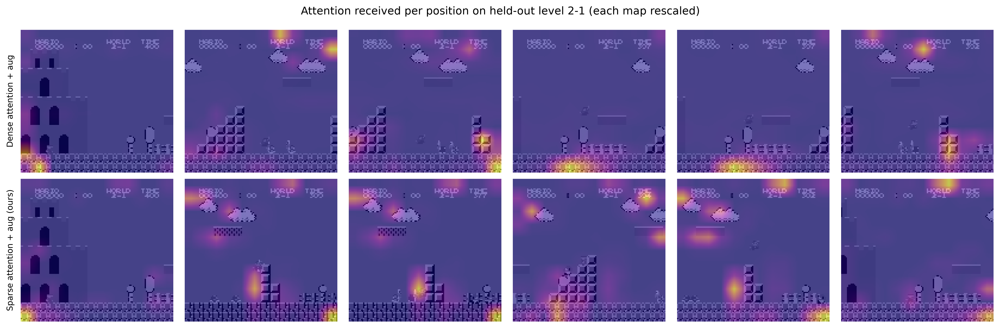
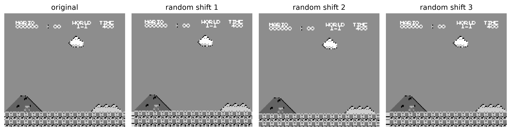
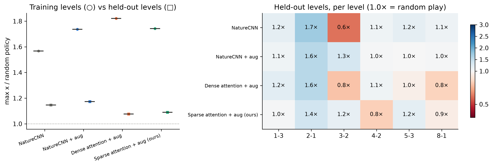
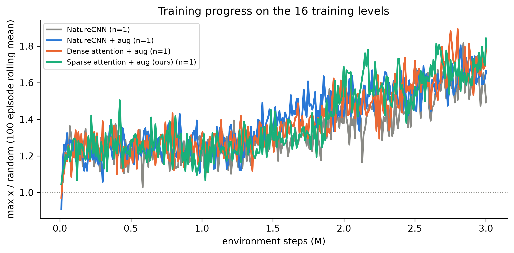
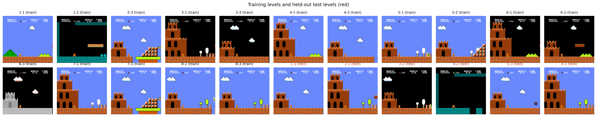
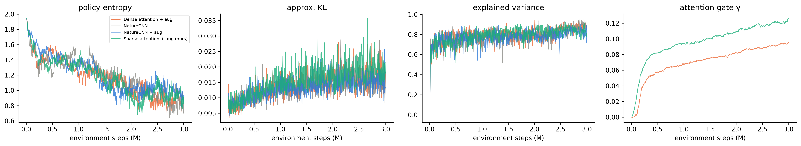

# Results: Generalisation of spatial attention in pixel-based PPO: Super Mario Bros. held-out levels

Generated 2026-10-31 03:28 · variants ['cnn', 'cnn_aug', 'attn_aug', 'sparse_aug'] · seeds [42] · 3,000,000 steps per run · train levels ['1-1', '1-2', '2-3', '3-1', '3-3', '4-1', '4-3', '5-1', '5-2', '6-1', '6-2', '6-3', '7-1', '7-3', '8-2', '8-3'] · held-out levels ['1-3', '2-1', '3-2', '4-2', '5-3', '8-1']

### Variants and model size

| Variant | Encoder | Block | Augmentation | Block params | Total params |
|:---|---:|---:|---:|---:|---:|
| NatureCNN | nature | baseline | no | 0 | 4,407,976 |
| NatureCNN + aug | nature | baseline | yes | 0 | 4,407,976 |
| Dense attention + aug | nature | spatial | yes | 16,385 | 4,424,361 |
| Sparse attention + aug (ours) | nature | sparse | yes | 24,833 | 4,432,809 |

### Random-policy mean max x per level (normaliser for all scores)

| Level | Split | Random mean max x |
|:---|---:|---:|
| 1-1 | train | 1,128 |
| 1-2 | train | 492 |
| 2-3 | train | 472 |
| 3-1 | train | 478 |
| 3-3 | train | 313 |
| 4-1 | train | 586 |
| 4-3 | train | 382 |
| 5-1 | train | 388 |
| 5-2 | train | 524 |
| 6-1 | train | 601 |
| 6-2 | train | 419 |
| 6-3 | train | 315 |
| 7-1 | train | 402 |
| 7-3 | train | 627 |
| 8-2 | train | 346 |
| 8-3 | train | 495 |
| 1-3 | test | 344 |
| 2-1 | test | 384 |
| 3-2 | test | 457 |
| 4-2 | test | 246 |
| 5-3 | test | 316 |
| 8-1 | test | 426 |

### Mean max x relative to random play, mean ± std over seeds (16 training, 6 held-out levels)

| Variant | Seeds | Train levels (× random) | Held-out levels (× random) | Generalisation gap | Held-out flags |
|:---|---:|---:|---:|---:|---:|
| NatureCNN | 1 | 1.57 | 1.15 | 0.42 | 0 |
| NatureCNN + aug | 1 | 1.74 | 1.17 | 0.56 | 0 |
| Dense attention + aug | 1 | 1.82 | 1.08 | 0.75 | 0 |
| Sparse attention + aug (ours) | 1 | 1.74 | 1.09 | 0.65 | 0 |

### Attention focus on held-out level 2-1 (normalised entropy, 1 = uniform), seed 42

| Variant | Level | Mean row entropy | Received-attention entropy | γ |
|:---|---:|---:|---:|---:|
| Dense attention + aug | 2-1 | 0.552 | 0.700 | 0.095 |
| Sparse attention + aug (ours) | 2-1 | 0.524 | 0.696 | 0.126 |

### Policy latency at batch 1 (budget 66.6 ms)

| Variant | Device | Mean (ms) | p95 (ms) | Real-time |
|:---|---:|---:|---:|---:|
| NatureCNN | CPU | 0.930 | 3.574 | yes |
| NatureCNN + aug | CPU | 0.570 | 0.667 | yes |
| Dense attention + aug | CPU | 0.699 | 0.731 | yes |
| Sparse attention + aug (ours) | CPU | 1.151 | 1.206 | yes |
| NatureCNN | CUDA | 0.348 | 0.389 | yes |
| NatureCNN + aug | CUDA | 0.343 | 0.377 | yes |
| Dense attention + aug | CUDA | 0.471 | 0.503 | yes |
| Sparse attention + aug (ours) | CUDA | 0.647 | 0.686 | yes |

## Figures

## Animations

